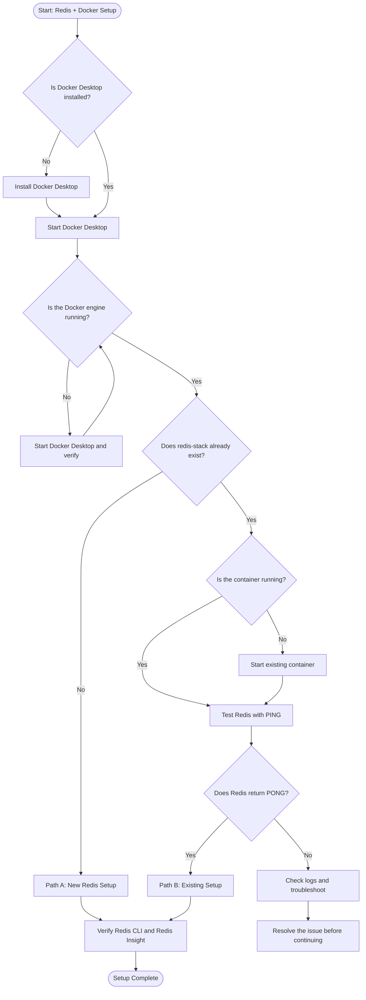

# Redis + Docker on Windows — Complete Setup Guide

A step-by-step guide to setting up Redis Stack using Docker Desktop on Windows, with WSL 2, Ubuntu, Redis CLI, Redis Insight, Docker volumes, and Docker Compose.

## Table of Contents

1. Introduction
2. Architecture
3. Prerequisites
4. Install WSL 2 and Ubuntu
5. Install Docker Desktop
6. Verify Docker
7. Run Redis Stack
8. Connect using Redis CLI
9. Open Redis Insight
10. Configure Docker Compose
11. Data persistence and volumes
12. Docker management commands
13. Troubleshooting
14. Security checklist
15. Official documentation
16. Publish this guide on GitHub

---

## 1. Introduction

Redis is an in-memory data store commonly used for caching, session storage, counters, real-time applications, and messaging.

Docker lets us run Redis in an isolated container without installing the Redis server directly on Windows.

In this setup, we will use:

- **Docker Desktop:** Runs and manages containers.
- **WSL 2:** Provides the Linux environment used by Docker Desktop.
- **Ubuntu:** Linux distribution available through WSL.
- **Redis Stack:** Redis server with additional modules available in supported versions.
- **Redis CLI:** Terminal interface for interacting with Redis.
- **Redis Insight:** Graphical interface for inspecting Redis data.
- **Docker volume:** Stores Redis data files outside the container's writable layer.

The goal is to create a working Redis development environment that can be reproduced by other developers.

## 2. Architecture

```text
                 Windows PC
                     |
              Docker Desktop
                     |
                  WSL 2
                     |
              Redis Stack
               Container
              /          \
             /            \
    Redis Server       Redis Insight
     Port 6379           Port 8001
         |                   |
     Redis CLI            Browser
```

Default local addresses:

- Redis server: `127.0.0.1:6379`
- Redis Insight: `http://localhost:8001`

## 3. Prerequisites

Before beginning, make sure you have:

- Windows 10 or Windows 11 supported by the current Docker Desktop release.
- Administrator access for installing WSL, if required.
- Internet access.
- Hardware virtualization enabled where required.
- A GitHub account to publish this documentation.

Check Docker Desktop's current requirements:

[https://docs.docker.com/desktop/setup/install/windows-install/](https://docs.docker.com/desktop/setup/install/windows-install/)

## 4. Install WSL 2 and Ubuntu

### Step 1: Open PowerShell as Administrator

Open the Windows Start menu, search for PowerShell, right-click it, and select **Run as administrator**.

Run:

```powershell
wsl --install
```

This installs WSL and a default Linux distribution on supported Windows systems.

Restart your computer if requested.

### Step 2: If Ubuntu installation fails

If the distribution download fails, try:

```powershell
wsl --install --web-download -d Ubuntu
```

Wait for the installation to finish.

### Step 3: Create your Ubuntu account

Open Ubuntu from the Windows Start menu.

Create a Linux username and password when prompted. These credentials are separate from your Windows account.

When entering your Linux password, the terminal may not display characters. This is normal.

### Step 4: Verify WSL

Return to PowerShell and run:

```powershell
wsl --version
wsl --status
wsl -l -v
```

Confirm that Ubuntu is using WSL version 2.

If Ubuntu is using version 1, run:

```powershell
wsl --set-version Ubuntu 2
```

Official documentation:

[https://learn.microsoft.com/windows/wsl/install](https://learn.microsoft.com/windows/wsl/install)

## 5. Install Docker Desktop

### Step 1: Download Docker Desktop

Open the official download and installation page:

[https://docs.docker.com/desktop/setup/install/windows-install/](https://docs.docker.com/desktop/setup/install/windows-install/)

Download the installer that matches your computer's architecture. Most Intel and AMD Windows PCs use the x86-64/AMD64 architecture.

### Step 2: Install Docker Desktop

1. Run the downloaded installer.
2. Select the WSL 2 backend if prompted.
3. Complete the installation.
4. Restart Windows if required.
5. Open Docker Desktop.
6. Wait until the Docker engine is running.

Do not continue until Docker Desktop has finished starting.

### Step 3: Configure WSL integration

If needed, open Docker Desktop settings and find the WSL integration section.

Enable integration for your Ubuntu distribution, if that option is available and relevant to your configuration.

Official documentation:

[https://docs.docker.com/desktop/features/wsl/](https://docs.docker.com/desktop/features/wsl/)

## 6. Verify Docker installation

Open PowerShell and execute:

```powershell
docker --version
docker compose version
docker info
```

These commands check the Docker client, Compose plugin, and engine information.

### Test Docker with a sample container

```powershell
docker run --rm hello-world
```

A successful run displays a message confirming that Docker can run a container.

If Docker reports that the engine is unavailable, open Docker Desktop and wait until its engine is running before trying again.

---

## 7. Run Redis Stack

**Important:** If you already have a working container named `redis-stack`, inspect it before creating another. Do not remove an existing container or its volume until you know whether you need its data.

Check existing containers:

```powershell
docker ps -a
```

Check existing volumes:

```powershell
docker volume ls
```

If your current Redis installation is already working, skip to Section 8 and verify it.

### Step 1: Pull the Redis Stack image

```powershell
docker pull redis/redis-stack:latest
```

This downloads the image to your computer.

### Step 2: Create a named volume

```powershell
docker volume create redis-data
```

Inspect the volume:

```powershell
docker volume inspect redis-data
```

A named volume stores data separately from the container's writable layer.

However, a volume alone does not guarantee that Redis is saving data to disk. Redis persistence must also be configured.

### Step 3: Start Redis Stack

For a new development container, run this command in **Windows PowerShell**:

```powershell
docker run -d `
  --name redis-stack `
  --restart unless-stopped `
  -p 127.0.0.1:6379:6379 `
  -p 127.0.0.1:8001:8001 `
  -v redis-data:/data `
  -e REDIS_ARGS="--appendonly yes --appendfsync everysec" `
  redis/redis-stack:latest
```

Explanation:

| Option                     | Meaning                                                                   |
| -------------------------- | ------------------------------------------------------------------------- |
| `-d`                       | Run in the background                                                     |
| `--name redis-stack`       | Assign a container name                                                   |
| `--restart unless-stopped` | Restart automatically unless manually stopped                             |
| `127.0.0.1:6379:6379`      | Make Redis available locally                                              |
| `127.0.0.1:8001:8001`      | Make Redis Insight available locally                                      |
| `-v redis-data:/data`      | Mount a named data volume                                                 |
| `REDIS_ARGS`               | Enable AOF persistence with approximately once-per-second synchronization |

The `latest` image tag may change over time. For a reproducible team environment, choose and test a specific image version.

AOF helps with recovery but does not replace independent backups. A sudden failure may lose recent writes, and durability depends on the configuration and storage environment.

### Step 4: Verify the container

```powershell
docker ps
```

You should see a running container named `redis-stack` and port mappings for 6379 and 8001.

Inspect its logs:

```powershell
docker logs redis-stack
```

Test Redis:

```powershell
docker exec -it redis-stack redis-cli PING
```

Expected output:

```text
PONG
```

---

## 8. Connect using Redis CLI

Redis CLI allows you to interact with the Redis server from your terminal.

Open the CLI:

```powershell
docker exec -it redis-stack redis-cli
```

You should see a prompt similar to:

```text
127.0.0.1:6379>
```

Run these commands individually:

```redis
PING
SET setup:status complete
GET setup:status
EXISTS setup:status
TYPE setup:status
```

Expected responses include:

```text
PONG
OK
"complete"
(integer) 1
string
```

Try a temporary key:

```redis
SET setup:temporary "temporary value" EX 60
TTL setup:temporary
GET setup:temporary
```

The key expires after approximately 60 seconds.

Exit Redis CLI:

```redis
EXIT
```

This verifies that your client can communicate with the Redis server.

## 9. Open Redis Insight

Open your browser and visit:

[http://localhost:8001](http://localhost:8001)

Redis Insight provides a graphical interface for viewing and exploring Redis data.

Depending on the installed version, it may open directly or ask you to add a database connection.

If you need to add a connection manually, use:

- Host: `127.0.0.1`
- Port: `6379`
- Username/password: Only if you configured authentication.

After connecting, inspect the keys created in Section 8.

If the page does not open, check the container's status and port mapping:

```powershell
docker ps
docker logs redis-stack
```

## 10. Configure Docker Compose

Docker Compose stores your container configuration in a file. This makes the setup easier to repeat and share with other developers.

**Do not start this Compose configuration while another container is already using the same container name or host ports.** First decide whether to keep your current container or migrate to the Compose-managed setup.

### Step 1: Create a project folder

```powershell
mkdir redis-docker-setup-guide
cd redis-docker-setup-guide
```

### Step 2: Create `compose.yaml`

Add the following content:

```yaml
services:
  redis:
    image: redis/redis-stack:latest
    container_name: redis-stack
    restart: unless-stopped
    ports:
      - "127.0.0.1:6379:6379"
      - "127.0.0.1:8001:8001"
    volumes:
      - redis-data:/data
    environment:
      REDIS_ARGS: "--appendonly yes --appendfsync everysec"
    healthcheck:
      test: ["CMD", "redis-cli", "ping"]
      interval: 10s
      timeout: 3s
      retries: 5

volumes:
  redis-data:
```

### Step 3: Start the Compose project

From the folder containing `compose.yaml`, run:

```powershell
docker compose up -d
```

Check its status:

```powershell
docker compose ps
docker compose logs -f redis
```

Test Redis:

```powershell
docker exec -it redis-stack redis-cli PING
```

### Step 4: Stop and start the project

Stop the project:

```powershell
docker compose down
```

Start it again:

```powershell
docker compose up -d
```

The normal `docker compose down` command preserves named volumes. Avoid `docker compose down -v` unless you intentionally want to remove the Compose-managed volumes and their stored data.

## 11. Data persistence and Docker volumes

Redis is primarily an in-memory data store, but it supports persistence mechanisms that can write data to disk.

### Check AOF configuration

```powershell
docker exec redis-stack redis-cli CONFIG GET appendonly
```

### Check RDB snapshot rules

```powershell
docker exec redis-stack redis-cli CONFIG GET save
```

### Check persistence status

```powershell
docker exec redis-stack redis-cli INFO persistence
```

These commands help you inspect the server's persistence configuration and current status.

A named volume preserves data files outside the container, but successful recovery also depends on Redis persistence settings, storage integrity, and proper backup procedures.

Before relying on Redis for important data, learn how to create backups and test restoring them.

**Warning:** Do not delete `redis-data` or run volume-removal commands unless you have confirmed that the data is no longer needed.

---

## 12. Docker management commands

### View running containers

```powershell
docker ps
```

### View all containers

```powershell
docker ps -a
```

### View Redis logs

```powershell
docker logs redis-stack
```

### Follow logs

```powershell
docker logs -f redis-stack
```

### Stop Redis

```powershell
docker stop redis-stack
```

### Start an existing container

```powershell
docker start redis-stack
```

### Enter Redis CLI

```powershell
docker exec -it redis-stack redis-cli
```

### Inspect volumes

```powershell
docker volume ls
docker volume inspect redis-data
```

Removing a container and removing a volume are different operations. A named volume can survive container removal, but deleting the volume removes the data stored in it.

## 13. Troubleshooting

### Problem 1: Docker engine is unavailable

**Possible cause:** Docker Desktop has not finished starting.

**Solution:**

1. Open Docker Desktop.
2. Wait until the engine is running.
3. Run:

```powershell
docker info
```

### Problem 2: Container name already exists

Check all containers:

```powershell
docker ps -a
```

Inspect the existing container before deciding whether to reuse or replace it. Do not delete it blindly.

### Problem 3: Port 6379 or 8001 is already allocated

Check existing port mappings:

```powershell
docker ps
```

Identify the application using the port before stopping or reconfiguring anything.

### Problem 4: Redis does not respond

```powershell
docker ps
docker logs redis-stack
docker exec -it redis-stack redis-cli PING
```

Check that the container is running and Redis has started successfully.

### Problem 5: Redis Insight does not open

- Check the container status.
- Confirm that port 8001 is mapped.
- Check the container logs.
- Ensure another application is not using port 8001.

### Problem 6: Ubuntu or WSL installation fails

```powershell
wsl --status
wsl -l -v
```

Use Microsoft's current installation instructions if further troubleshooting is needed:

[https://learn.microsoft.com/windows/wsl/install](https://learn.microsoft.com/windows/wsl/install)

### Problem 7: Redis data appears missing

Check the container and volume:

```powershell
docker ps -a
docker volume ls
docker inspect redis-stack
```

You may be using a different container or volume. Do not delete old volumes until you have identified the original data location.

---

## 14. Security checklist

This guide is intended for local development.

- Keep Redis ports bound to `127.0.0.1`.
- Do not expose Redis port 6379 directly to the public internet.
- Do not commit passwords, access tokens, or private connection strings to GitHub.
- Do not treat this single-container setup as a production-ready high-availability deployment.
- Before production use, study Redis ACLs, authentication, TLS, network isolation, memory management, monitoring, backups, and recovery.

## 15. Official documentation

- Docker Desktop for Windows: [https://docs.docker.com/desktop/setup/install/windows-install/](https://docs.docker.com/desktop/setup/install/windows-install/)
- Docker with WSL 2: [https://docs.docker.com/desktop/features/wsl/](https://docs.docker.com/desktop/features/wsl/)
- Microsoft WSL installation: [https://learn.microsoft.com/windows/wsl/install](https://learn.microsoft.com/windows/wsl/install)
- Redis documentation: [https://redis.io/docs/latest/](https://redis.io/docs/latest/)
- Redis Stack Docker installation: [https://redis.io/docs/latest/operate/oss_and_stack/install/archive/install-stack/docker/](https://redis.io/docs/latest/operate/oss_and_stack/install/archive/install-stack/docker/)
- Redis Stack Docker image: [https://hub.docker.com/r/redis/redis-stack](https://hub.docker.com/r/redis/redis-stack)

## 16. Publish this setup guide on GitHub

### Step 1: Create a repository

Open:

[https://github.com/new](https://github.com/new)

Enter:

- Repository name: `redis-docker-setup-guide`
- Description: `Complete Redis Stack setup on Windows using Docker Desktop and WSL 2`
- Visibility: Public

If you plan to paste this README yourself, leave the option to initialize a README unchecked.

Click **Create repository**.

### Step 2: Add the documentation

1. Open the repository.
2. Click **Add file → Create new file**.
3. Enter `README.md`.
4. Paste this entire guide.
5. Click **Commit changes**.

### Step 3: Add the Compose configuration

Repeat the process to create `compose.yaml` and paste the Compose configuration from Section 10.

### Step 4: Verify your repository

Open the repository page and check that:

- The README displays correctly.
- The code blocks are readable.
- The official links work.
- The repository visibility is Public.

### Step 5: Share it with friends

Your repository link will look like:

`https://github.com/YOUR-USERNAME/redis-docker-setup-guide`

Replace `YOUR-USERNAME` with your GitHub username.

## Final Setup Checklist

Before moving to Redis learning topics, verify each item:

- [ ] WSL 2 and Ubuntu installed.
- [ ] Docker Desktop installed and running.
- [ ] `docker run --rm hello-world` succeeds.
- [ ] Redis Stack container is running.
- [ ] Redis CLI returns `PONG`.
- [ ] Redis Insight opens in the browser.
- [ ] You know which Docker volume stores your Redis data.
- [ ] Persistence configuration has been inspected.
- [ ] The README is published on GitHub.
- [ ] The public repository link opens successfully.

**Setup milestone:** Complete and verify this environment first. After that, the next document can cover Redis fundamentals, data structures, commands, and hands-on exercises.


# Redis + Docker Setup — Command Reference

## 1. Windows PowerShell (Run as Administrator when required)

**Use this terminal for:** installing WSL, checking Windows setup, and managing Docker.

### A. Install and verify WSL 2

```powershell
wsl --install
```

If Ubuntu installation fails:

```powershell
wsl --install --web-download -d Ubuntu
```

Verify WSL:

```powershell
wsl --version
wsl --status
wsl -l -v
```

If Ubuntu is using WSL 1:

```powershell
wsl --set-version Ubuntu 2
```

### B. Verify Docker Desktop

Open Docker Desktop first, then run:

```powershell
docker --version
docker compose version
docker info
```

Test Docker:

```powershell
docker run --rm hello-world
```

### C. Check existing Redis containers and volumes

```powershell
docker ps -a
docker volume ls
```

Inspect the existing Redis container:

```powershell
docker inspect redis-stack
```

**Important:** If `redis-stack` already exists, do not create another container with the same name or delete its volume.

### D. Create a Redis volume

Only if you need to create the volume:

```powershell
docker volume create redis-data
docker volume inspect redis-data
```

### E. Start a new Redis Stack container

Use this only when you have confirmed that the container name and ports are available.

```powershell
docker pull redis/redis-stack:latest
```

```powershell
docker run -d `
  --name redis-stack `
  --restart unless-stopped `
  -p 127.0.0.1:6379:6379 `
  -p 127.0.0.1:8001:8001 `
  -v redis-data:/data `
  -e REDIS_ARGS="--appendonly yes --appendfsync everysec" `
  redis/redis-stack:latest
```

Verify the container:

```powershell
docker ps
docker logs redis-stack
docker exec -it redis-stack redis-cli PING
```

Expected Redis response:

```text
PONG
```

### F. Manage the Redis container

```powershell
docker stop redis-stack
docker start redis-stack
docker restart redis-stack
docker logs -f redis-stack
```

Enter Redis CLI:

```powershell
docker exec -it redis-stack redis-cli
```

### G. Inspect persistence

```powershell
docker exec redis-stack redis-cli CONFIG GET appendonly
docker exec redis-stack redis-cli CONFIG GET save
docker exec redis-stack redis-cli INFO persistence
```

These commands inspect the current configuration; they do not enable persistence.

---

## 2. Ubuntu Terminal (WSL 2)

**Use this terminal for:** Linux commands and Linux-based development tasks.

Open Ubuntu from the Windows Start menu.

Check your Linux environment:

```bash
whoami
pwd
uname -a
```

Check WSL information from Windows PowerShell if needed:

```powershell
wsl -l -v
```

Docker commands may also work inside Ubuntu when Docker Desktop's WSL integration is enabled:

```bash
docker --version
docker ps
```

If Docker is unavailable in Ubuntu, check Docker Desktop's WSL integration settings.

---

## 3. Redis CLI (Redis command prompt)

**First, open PowerShell** and run:

```powershell
docker exec -it redis-stack redis-cli
```

Once you see the Redis prompt, run the following commands **inside Redis CLI**, not in PowerShell or Ubuntu.

### A. Test the connection

```redis
PING
```

Expected:

```text
PONG
```

### B. Create and retrieve a key

```redis
SET setup:status complete
GET setup:status
```

Expected:

```text
OK
"complete"
```

### C. Check a key

```redis
EXISTS setup:status
TYPE setup:status
```

### D. Test key expiration

```redis
SET setup:temporary "temporary value" EX 60
TTL setup:temporary
GET setup:temporary
```

The temporary key expires after approximately 60 seconds.

### E. Exit Redis CLI

```redis
EXIT
```

---

## 4. Web Browser — Redis Insight

**Use this for:** viewing and exploring Redis data through a graphical interface.

Open:

http://localhost:8001

If you need to add a database connection manually:

- Host: `127.0.0.1`
- Port: `6379`
- Username/password: only if authentication is configured.

If Redis Insight does not open, return to PowerShell and run:

```powershell
docker ps
docker logs redis-stack
```

---

## 5. Docker Compose — `compose.yaml`

**Use this file for:** storing your Redis configuration so you can reproduce the setup.

Create a project folder in PowerShell:

```powershell
mkdir redis-docker-setup-guide
cd redis-docker-setup-guide
```

Create a file named `compose.yaml` and paste:

```yaml
services:
  redis:
    image: redis/redis-stack:latest
    container_name: redis-stack
    restart: unless-stopped
    ports:
      - "127.0.0.1:6379:6379"
      - "127.0.0.1:8001:8001"
    volumes:
      - redis-data:/data
    environment:
      REDIS_ARGS: "--appendonly yes --appendfsync everysec"
    healthcheck:
      test: ["CMD", "redis-cli", "ping"]
      interval: 10s
      timeout: 3s
      retries: 5

volumes:
  redis-data:
```

Run these commands from the folder containing `compose.yaml`:

```powershell
docker compose up -d
docker compose ps
docker compose logs -f redis
```

Test the Redis server:

```powershell
docker exec -it redis-stack redis-cli PING
```

Stop the Compose project:

```powershell
docker compose down
```

**Warning:** Do not start this Compose project while an existing container uses the same name or ports. The normal `docker compose down` preserves named volumes; `docker compose down -v` can remove Compose-managed volumes and their data.

---

## 6. GitHub — Publish the README

1. Create a public repository at https://github.com/new.
2. Name it `redis-docker-setup-guide`.
3. Open **Add file → Create new file**.
4. Name the file `README.md`.
5. Paste your documentation.
6. Commit the changes.
7. Add `compose.yaml` as a separate file if you want to share the runnable configuration.

Your repository URL will look like:

```text
https://github.com/YOUR-USERNAME/redis-docker-setup-guide
```

Replace `YOUR-USERNAME` with your GitHub username.

## Quick Reference

| Where to run it | Typical commands |
|---|---|
| Windows PowerShell | `docker ps`, `docker logs redis-stack` |
| Ubuntu / WSL 2 | `whoami`, `pwd`, `uname -a` |
| Redis CLI | `PING`, `SET`, `GET`, `TTL` |
| Web browser | `http://localhost:8001` |
| Compose file | `compose.yaml` |
| GitHub | `README.md` |

**Remember:** PowerShell commands manage Docker, Redis CLI commands interact with Redis, and Redis Insight lets you view data in your browser.


# Redis Stack with Docker on Windows

## Choose Your Setup

- **Path A — New Setup:** You have not created a Redis Stack container yet.
- **Path B — Existing Setup:** You already have a `redis-stack` container and want to verify or manage it without losing data.

**Important:** Do not run the new-container commands in Path A if you already have a container using the same name or ports.

---

# Path A: New Redis Setup

Use this path for the first-time installation.

## Step 1: Verify prerequisites

**Terminal: Windows PowerShell**

Open Docker Desktop and wait until its engine is running.

```powershell
docker --version
docker compose version
docker info
```

Test Docker:

```powershell
docker run --rm hello-world
```

If these commands succeed, continue.

## Step 2: Download the Redis Stack image

**Terminal: Windows PowerShell**

```powershell
docker pull redis/redis-stack:latest
```

## Step 3: Create a Docker volume

**Terminal: Windows PowerShell**

```powershell
docker volume create redis-data
```

Verify it:

```powershell
docker volume inspect redis-data
```

The named volume stores data files outside the container's writable layer. Redis persistence must also be configured.

## Step 4: Start a new Redis Stack container

**Terminal: Windows PowerShell**

Run the following command as a single PowerShell command block:

```powershell
docker run -d `
  --name redis-stack `
  --restart unless-stopped `
  -p 127.0.0.1:6379:6379 `
  -p 127.0.0.1:8001:8001 `
  -v redis-data:/data `
  -e REDIS_ARGS="--appendonly yes --appendfsync everysec" `
  redis/redis-stack:latest
```

This configuration:
- Runs Redis Stack in the background.
- Maps Redis to local port `6379`.
- Maps Redis Insight to local port `8001`.
- Mounts the `redis-data` volume.
- Requests AOF persistence with periodic synchronization.

## Step 5: Verify the new container

**Terminal: Windows PowerShell**

```powershell
docker ps
docker logs redis-stack
docker exec -it redis-stack redis-cli PING
```

Expected Redis response:

```text
PONG
```

## Step 6: Test Redis commands

**First, enter Redis CLI from PowerShell:**

```powershell
docker exec -it redis-stack redis-cli
```

**Now run these commands inside Redis CLI:**

```redis
PING
SET setup:status complete
GET setup:status
EXISTS setup:status
TYPE setup:status
```

Expected values include `PONG`, `OK`, `"complete"`, `(integer) 1`, and `string`.

Exit Redis CLI:

```redis
EXIT
```

## Step 7: Open Redis Insight

**Application: Web browser**

Open:

http://localhost:8001

If the interface asks you to add a database, use:

- Host: `127.0.0.1`
- Port: `6379`
- Credentials: only if you configured authentication.

## Step 8: Verify persistence settings

**Terminal: Windows PowerShell**

```powershell
docker exec redis-stack redis-cli CONFIG GET appendonly
docker exec redis-stack redis-cli CONFIG GET save
docker exec redis-stack redis-cli INFO persistence
```

These commands inspect the current persistence configuration and status.

---

# Path B: Existing Redis Setup

Use this path if Redis Stack is already installed or the `redis-stack` container already exists.

**Do not pull, recreate, delete, or replace your existing container just to verify it.**

## Step 1: Check the container

**Terminal: Windows PowerShell**

```powershell
docker ps -a
```

Look for a container named `redis-stack`.

If its status is `Up`, continue to Step 2.

If its status is `Exited`, continue to Step 3.

## Step 2: Test a running Redis container

**Terminal: Windows PowerShell**

```powershell
docker exec -it redis-stack redis-cli PING
```

Expected response:

```text
PONG
```

If this succeeds, your Redis server is responding. You do not need to create another container.

## Step 3: Start a stopped container

Only do this if `docker ps -a` shows that the existing container is stopped.

**Terminal: Windows PowerShell**

```powershell
docker start redis-stack
```

Then verify:

```powershell
docker ps
docker logs redis-stack
docker exec -it redis-stack redis-cli PING
```

## Step 4: Open Redis CLI

**Terminal: Windows PowerShell**

```powershell
docker exec -it redis-stack redis-cli
```

**Inside Redis CLI:**

```redis
PING
SET setup:check working
GET setup:check
```

Exit:

```redis
EXIT
```

## Step 5: Check Redis Insight

**Application: Web browser**

Open:

http://localhost:8001

If it does not open, check the existing container's ports and logs.

**Terminal: Windows PowerShell**

```powershell
docker ps
docker logs redis-stack
docker port redis-stack
```

Do not start another container to fix a browser issue until you have checked the current container.

## Step 6: Identify the existing data volume

**Terminal: Windows PowerShell**

```powershell
docker inspect redis-stack
docker volume ls
```

To inspect a known volume:

```powershell
docker volume inspect redis-data
```

Do not assume the existing container uses `redis-data`. Inspect the container's mount configuration and identify its actual volume before changing anything.

## Step 7: Inspect persistence

**Terminal: Windows PowerShell**

```powershell
docker exec redis-stack redis-cli CONFIG GET appendonly
docker exec redis-stack redis-cli CONFIG GET save
docker exec redis-stack redis-cli INFO persistence
```

If AOF is disabled, do not assume that the data is being saved through AOF. Inspect the existing configuration before changing it.

## Step 8: Manage the existing container

**Terminal: Windows PowerShell**

Stop Redis:

```powershell
docker stop redis-stack
```

Start it again:

```powershell
docker start redis-stack
```

Restart it:

```powershell
docker restart redis-stack
```

View logs:

```powershell
docker logs -f redis-stack
```

These commands manage the existing container without intentionally deleting it or its volume.

---

# Docker Compose: Optional for Either Setup

Docker Compose is an alternative way to manage Redis. It is not necessary if your existing container already works.

Create a file named `compose.yaml`:

```yaml
services:
  redis:
    image: redis/redis-stack:latest
    container_name: redis-stack
    restart: unless-stopped
    ports:
      - "127.0.0.1:6379:6379"
      - "127.0.0.1:8001:8001"
    volumes:
      - redis-data:/data
    environment:
      REDIS_ARGS: "--appendonly yes --appendfsync everysec"
    healthcheck:
      test: ["CMD", "redis-cli", "ping"]
      interval: 10s
      timeout: 3s
      retries: 5

volumes:
  redis-data:
```

**Before starting Compose:** Check whether the existing container already uses the name `redis-stack` or the required ports. Decide how to reuse or migrate your setup first; do not run both configurations blindly.

From the directory containing `compose.yaml`, run:

```powershell
docker compose up -d
docker compose ps
```

To stop the Compose project:

```powershell
docker compose down
```

The normal `docker compose down` preserves its named volume. Avoid `docker compose down -v` unless you intentionally want to remove Compose-managed volumes and their stored data.

---

# Troubleshooting

| Problem | Commands to run in PowerShell |
|---|---|
| Container not found | `docker ps -a` |
| Container stopped | `docker start redis-stack` |
| Redis not responding | `docker logs redis-stack` |
| Redis Insight unavailable | `docker port redis-stack` |
| Need to inspect volumes | `docker volume ls` |
| Need to inspect container mounts | `docker inspect redis-stack` |

## Official Documentation

- [Docker Desktop for Windows](https://docs.docker.com/desktop/setup/install/windows-install/)
- [Docker Desktop WSL 2](https://docs.docker.com/desktop/features/wsl/)
- [Redis documentation](https://redis.io/docs/latest/)
- [Redis Stack Docker image](https://hub.docker.com/r/redis/redis-stack)

## Final Checklist

### New setup
- [ ] Docker works.
- [ ] Redis Stack container starts.
- [ ] Redis CLI returns `PONG`.
- [ ] Redis Insight opens.
- [ ] The data volume and persistence settings are verified.

### Existing setup
- [ ] Existing container identified.
- [ ] Redis CLI returns `PONG`.
- [ ] Existing volume identified.
- [ ] Persistence configuration inspected.
- [ ] No existing data was deleted.

**Next step:** Once either path is working, continue with Redis fundamentals: strings, hashes, lists, sets, sorted sets, expiration, caching, and practical exercises.


## Quick Decision Flowchart



### How to choose your path

- **Path A — New Setup:** No `redis-stack` container exists. Follow the steps to pull the image, create a volume, and start the container.
- **Path B — Existing Setup:** The container already exists. Check its status, test Redis, and inspect its current volume and persistence settings before making changes.
- **Troubleshooting:** Redis does not respond with `PONG`, or the container cannot start. Check its logs and configuration first.

**Important:** An existing but stopped container is still an existing setup. Start and inspect it instead of creating a duplicate. Never delete a container or volume until you have confirmed that its data is no longer needed.